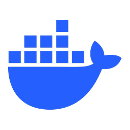
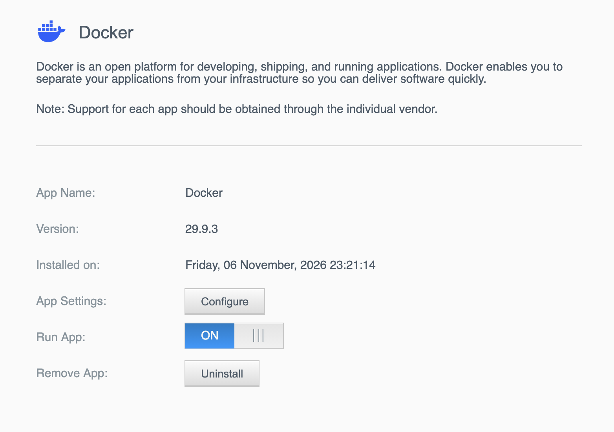

<div align="center">

<h1 align="center">Docker for WD My Cloud</h1>

**The official Docker Engine, always up to date, on your WD My Cloud OS5 NAS: installed and updated from the dashboard.**

<p align="center">
<a href="https://github.com/polius/wd-mycloud-docker/actions/workflows/release.yml"></a>&nbsp;<a href="https://github.com/polius/wd-mycloud-docker/releases/latest"></a>&nbsp;<a href="https://github.com/polius/wd-mycloud-docker/releases"></a>&nbsp;<a href="LICENSE"></a>
</p>

<br>



</div>

## Features

- **Official Docker, unmodified**: Docker's own static binaries from download.docker.com, plus the official `docker compose` plugin. Every release lists their checksums.
- **Always current**: a new release is built automatically within a day of every Docker release.
- **Install and update from the dashboard**: upload one `.bin` file. No SSH needed to install or update.
- **Your containers survive updates**: images, containers, volumes and settings live outside the app, so updating Docker never deletes them.
- **Starts by itself at boot**: containers with a restart policy come back after every reboot and update.
- **Made for this firmware**: handles what the WD kernel lacks (overlayfs, cgroup layout, iptables `raw` table), tested on a real My Cloud PR2100.
- **Transparent**: three readable shell scripts, built in public by GitHub Actions. Nothing is hidden in the package.

## Supported devices

The Docker Engine is built for x86_64, so this works on the Intel-based My Cloud models running **My Cloud OS 5**.

| Model | Status |
|---|---|
| My Cloud PR2100 | ✅ Tested (OS 5.33.102) |
| My Cloud PR4100 | Expected to work (same hardware family and firmware), not yet tested: reports welcome |

ARM-based models (EX2 Ultra, EX2100, EX4100, Mirror Gen 2) are not supported.

## Install

1. Download the `.bin` for your model from the [latest release](https://github.com/polius/wd-mycloud-docker/releases/latest), e.g. `MyCloudPR2100_docker_29.9.3.bin`.
2. Open the NAS dashboard and go to **Apps > Install an app manually**.
3. Choose the `.bin` file.

That's it. Docker starts right away, and the app's **Configure** button opens a page that shows what is installed and where everything is on your NAS.

> **Already running Docker** through the old community app? Follow [Migrating from the community Docker app](#migrating-from-the-community-docker-app) instead, so your containers come along.

## Using Docker

Docker is used over SSH, as on any Linux machine. Turn SSH on in the dashboard (**Settings > Network > SSH**), then log in as the user `sshd` with the password you set there:

```bash
ssh sshd@<nas-ip>
docker ps
docker compose version
```

Store your containers' data in a folder on the NAS volume (usually `/mnt/HD/HD_a2`), for example:

```bash
docker run -d \
  --name myapp \
  --restart unless-stopped \
  -v /mnt/HD/HD_a2/MyApp:/data \
  myimage
```

Give every container a restart policy (`--restart unless-stopped` or `always`, or `restart:` in a compose file). That is what brings it back after a reboot or a Docker update.

## Updating Docker

Install the `.bin` of the newer version, exactly like the first time: **Apps > Install an app manually**.

What happens:

1. Docker stops. All running containers are stopped gracefully (each gets up to 30 seconds).
2. The Docker program files are replaced with the new version.
3. Docker starts again, and containers with a restart policy start again by themselves.

**Nothing is deleted**: your images, containers, volumes, networks, settings and mounted folders all stay. Your services are down for the time Docker and your containers take to stop and start, usually a minute or two.

Containers created without a restart policy are not started again automatically: start them with `docker start <name>`, or give them one with `docker update --restart unless-stopped <name>`.

> [!TIP]
> Watch this repository's releases (**Watch > Custom > Releases**) to get a notification for every new Docker version.

## Where your data lives

The app keeps the Docker program and your data apart, the same way WD's own Plex app does (`Nas_Prog/plexmediaserver` and `Nas_Prog/plex_conf`):

| What | Where (on volume `/mnt/HD/HD_a2`) | Updates and uninstall |
|---|---|---|
| Docker program | `Nas_Prog/docker/engine/` | Replaced on update, removed on uninstall |
| Images, containers, volumes, networks | `Nas_Prog/docker_data/data/` | Never touched |
| Docker settings | `Nas_Prog/docker_data/daemon.json` | Never touched |
| Logs | `Nas_Prog/docker_data/logs/` | Never touched |
| Folders you mount into containers | wherever you chose | Never touched |

`daemon.json` is written once with defaults that suit this NAS, and is yours to edit afterwards (restart Docker to apply: `bash /mnt/HD/HD_a2/Nas_Prog/docker/dockerctl.sh --restart`).

## Uninstalling

In the dashboard, open the **Docker** app and choose **Uninstall**. This stops Docker and removes the program. Your data stays in `Nas_Prog/docker_data/` until you delete it yourself:

```bash
rm -rf /mnt/HD/HD_a2/Nas_Prog/docker_data
```

## Migrating from the community Docker app

If you run Docker through the older community app (WDCommunity, Docker 20.10), move your containers over in a few steps. Do this from your local network: if you reach the NAS remotely through a container (a Cloudflare tunnel, for example), that access goes down while Docker is switched.

1. **Save the commands that recreate your containers.** With the old Docker still running, on the NAS:

   ```bash
   mkdir -p /mnt/HD/HD_a2/docker-migration && cd /mnt/HD/HD_a2/docker-migration
   curl -fsSLO https://raw.githubusercontent.com/polius/wd-mycloud-docker/main/export-docker-run.sh
   bash export-docker-run.sh
   ```

   It only reads from Docker, and writes `docker-recreate-<date>.sh` (exact, **contains your containers' secrets**, readable only by root) and a `.redacted.sh` copy you can share. Review it: it notes anything that needs attention, such as data stored in Docker volumes or inside the old app's folder.

2. **Uninstall the old Docker app** in the dashboard. WD leaves its folder behind, and the new app installs into the same place, so remove it and restart the NAS:

   ```bash
   rm -rf /mnt/HD/HD_a2/Nas_Prog/docker
   reboot
   ```

3. **Install this app** ([Install](#install)).

4. **Recreate your containers:**

   ```bash
   sh /mnt/HD/HD_a2/docker-migration/docker-recreate-<date>.sh
   ```

   Images are pulled again by tag, so `:latest` images may be newer than the ones you had. Check that every container starts (`docker ps -a`); a much newer image may need a changed setting.

Your old Docker data stays untouched in `Nas_Prog/_docker/`. Delete it once everything runs (`rm -rf /mnt/HD/HD_a2/Nas_Prog/_docker`). Portainer, which the old app installed by itself, is left out of the export (`EXCLUDE="" bash export-docker-run.sh` includes it).

## Troubleshooting

<details>
<summary>Check what Docker is doing</summary>

```bash
bash /mnt/HD/HD_a2/Nas_Prog/docker/dockerctl.sh --status
tail -n 50 /mnt/HD/HD_a2/Nas_Prog/docker_data/logs/dockerd.log
tail -n 50 /mnt/HD/HD_a2/Nas_Prog/docker_data/logs/dockerctl.log
cat /tmp/debug_apkg      # what the NAS ran when installing or starting apps (cleared at reboot)
```

</details>

<details>
<summary>"another Docker daemon is running"</summary>

A different Docker (usually the old community app) is still running. Uninstall it in the dashboard, restart the NAS, and the app starts Docker by itself.

</details>

<details>
<summary>A container did not come back after an update or a reboot</summary>

It has no restart policy. Start it and give it one:

```bash
docker start <name>
docker update --restart unless-stopped <name>
```

</details>

<details>
<summary><code>docker: command not found</code> over SSH</summary>

The `docker` command links are created at every boot. If they are missing, recreate them:

```bash
bash /mnt/HD/HD_a2/Nas_Prog/docker/dockerctl.sh --links
```

</details>

<details>
<summary>Restart Docker</summary>

```bash
bash /mnt/HD/HD_a2/Nas_Prog/docker/dockerctl.sh --restart
```

Over SSH it runs in the background, so it finishes even if your connection drops; follow it with `tail -f /mnt/HD/HD_a2/Nas_Prog/docker_data/logs/dockerctl.log`.

</details>

## Good to know

- **Disk usage**: the WD kernel has no overlayfs, so Docker uses the `vfs` storage driver, which stores every image layer as a full copy. Images take several times more disk space than on a typical Linux machine (about 10 GB for ten common images).
- **cgroup v1**: the WD kernel (4.14) only has cgroup v1. Docker 29 supports it, but has announced its removal by May 2029. Releases follow Docker 29 automatically; a new major version is only published after it has been tested on a NAS.
- **Container port isolation**: the kernel has no iptables `raw` table, so Docker runs with `DOCKER_INSECURE_NO_IPTABLES_RAW=1`. This drops a hardening rule that blocks other hosts on your LAN from reaching container ports directly through routing; ports you publish with `-p` work as usual.
- **IPv6**: container IPv6 NAT is off (`"ip6tables": false`), because the kernel lacks `ip6table_nat`.
- **No bundled UI**: unlike the community app, Portainer is not installed. Run it as a container if you want it.

<details>
<summary>How it works</summary>

The `.bin` is a standard My Cloud OS5 app package, built with WD's `mksapkg-OS5` tool. Inside:

| Part | What it does |
|---|---|
| `engine/` | Docker's official static binaries (`dockerd`, `containerd`, `runc`, `docker`, …) and the `docker compose` plugin |
| `dockerctl.sh` | Starts and stops Docker: loads the network kernel modules, mounts the cgroup controllers, mounts `/dev/pts`, links `docker` into `/sbin`, writes `daemon.json` on first start, starts `dockerd` and stops it gracefully |
| `init.sh`, `start.sh`, `stop.sh` | Run by the NAS at boot and shutdown, and during install, update and uninstall; each calls `dockerctl.sh` |
| `install.sh`, `remove.sh` | Copy the app into `Nas_Prog/docker` / remove it again. Never touch `Nas_Prog/docker_data` |
| `web/` | The info page behind the **Configure** button, filled in with your NAS's real paths |

What the WD firmware needs, and what the app does about it:

| Firmware | The app |
|---|---|
| The root filesystem is rebuilt in RAM at every boot | Recreates the `docker` links and mounts at every boot (`init.sh`, `start.sh`) |
| No overlayfs | `"storage-driver": "vfs"` and the classic image store (`"containerd-snapshotter": false`) |
| One combined `cpu,memory` cgroup hierarchy on `/sys/fs/cgroup` | Replaces it with the standard layout (one mount per controller), only if nothing uses it |
| No iptables `raw` table, no `ip6table_nat` | `DOCKER_INSECURE_NO_IPTABLES_RAW=1`, `"ip6tables": false` |
| `pivot_root` fails on the RAM root filesystem | `DOCKER_RAMDISK=1` |
| No `setsid`, `/tmp` mounted `noexec` | Avoided in the scripts |

During an update, WD runs the old app's `stop.sh` and `remove.sh`, then the new `install.sh`, `init.sh` and `start.sh`.

</details>

## Building it yourself

Releases are built by [GitHub Actions](.github/workflows/release.yml), but you can build the same `.bin` on any computer with Docker (on Apple Silicon too, through emulation):

```bash
git clone https://github.com/polius/wd-mycloud-docker.git && cd wd-mycloud-docker
mkdir app-build && cp make-app.sh dockerctl.sh app-build/
docker run --rm --platform linux/amd64 -v "$PWD/app-build:/out" debian:bookworm-slim bash -c '
  apt-get update -qq &&
  apt-get install -y -qq --no-install-recommends curl ca-certificates openssl libxml2 >/dev/null &&
  bash /out/make-app.sh'
```

The build runs in a throwaway container that can only write to `app-build/`. Pass a version to build a specific one (`bash /out/make-app.sh 29.9.3`), and `-e MODELS="MyCloudPR2100"` to build only some models. It produces one `.bin` per model, `SHA256SUMS` and `release-notes.md`.

`make-app.sh` downloads WD's packaging tool from the [WDCommunity](https://github.com/WDCommunity/wdpksrc) project at a pinned commit and refuses to run it unless its SHA-256 matches.

## Verifying a release

Every release includes `SHA256SUMS`:

```bash
sha256sum -c SHA256SUMS        # Linux
shasum -a 256 -c SHA256SUMS    # macOS
```

The release notes also list the SHA-256 of Docker's official `docker-<version>.tgz`, so you can check that the engine inside the app is Docker's own, byte for byte.

## How releases are made

Every day, a [workflow](.github/workflows/release.yml) checks download.docker.com for a new stable Docker release. If there is one, it builds the app for every supported model and publishes it as a release named after the Docker version (`v29.9.3`). New major versions of Docker are published by hand, once tested on a NAS.

## Disclaimer

This is a community project. It is not affiliated with, endorsed by or supported by Docker, Inc. or Western Digital. Docker and the Docker logo are trademarks of Docker, Inc.; WD and My Cloud are trademarks of Western Digital. Use at your own risk: back up what matters before changing your NAS.

## License

[MIT](LICENSE)
